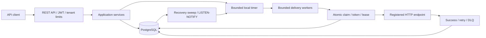

# Durable Scheduler

A multi-tenant scheduling API that persists future work in PostgreSQL and delivers it to registered HTTP endpoints. It supports multiple application instances in one region, bounded local timers, recovery after restart, versioned mutations, retries, dead-letter handling, and transactional history.

The purpose is to separate durable scheduling from business consumers. PostgreSQL owns state and concurrency; consumers own the business effect and must implement idempotency. Multi-region is outside the initial scope.

[Project documentation (pt-BR)](https://app.notion.com/p/3f82bc4433998168ba5fe966177cdb47) · [Architecture decisions](https://app.notion.com/p/3f82bc443399810f9cfaf1530fa32f67) · [Production acceptance](https://app.notion.com/p/3f82bc44339981dd9c7def416763f6b4)

## Contents

- [Architecture](#architecture)
- [Requirements](#requirements)
- [Quick start](#quick-start)
- [Use the API](#use-the-api)
- [Configuration](#configuration)
- [Build and test](#build-and-test)
- [Project structure](#project-structure)
- [Deployment and operations](#deployment-and-operations)
- [Contributing](#contributing)

## Architecture



The application persists before loading the timer. A periodic sweep rebuilds local queues, and PostgreSQL notifications reduce loading latency. Conditional SQL claims coordinate replicas; completion requires the current version, attempt token, and unexpired lease.

Delivery is **at least once**. A consumer may apply an effect before its response is lost, so retries carry the same `Idempotency-Key` for the same schedule version. Rescheduling and redrive increment the version and produce a new key. Cancellation is allowed before a claim; it cannot revoke an HTTP request already in progress.

States: `SCHEDULED`, `CLAIMED`, `RETRY_WAIT`, `DELIVERED`, `CANCELLED`, `DEAD_LETTERED`, and `EXPIRED`. No broker, sharding layer, or cross-region coordination is required by this implementation.

## Requirements

- JDK 21 or a compatible newer JDK; compilation targets Java 21.
- Docker for PostgreSQL and Testcontainers integration tests.
- Maven Wrapper included in the repository; dependency downloads require network access.
- `curl` and Python 3 for the examples below.

Run commands from the repository root. Check `java -version` and `./mvnw -version`; set `JAVA_HOME` if your default JDK is older than 21.

## Quick start

Start an isolated development database. The credentials and unauthenticated profile below are for local development.

```sh
docker run -d --name scheduler-readme-postgres \
  -p 127.0.0.1:5434:5432 \
  -e POSTGRES_DB=scheduler \
  -e POSTGRES_USER=scheduler \
  -e POSTGRES_PASSWORD=scheduler \
  postgres:17

docker exec scheduler-readme-postgres pg_isready -U scheduler -d scheduler
```

Wait until PostgreSQL accepts connections, then start the application in the foreground:

```sh
export SPRING_PROFILES_ACTIVE=local
export DATABASE_URL=jdbc:postgresql://localhost:5434/scheduler
export DATABASE_USER=scheduler
export DATABASE_PASSWORD=scheduler
export SERVER_ADDRESS=127.0.0.1
export SERVER_PORT=8085
./mvnw spring-boot:run
```

Flyway applies the schema on local startup. In another terminal:

```sh
curl --fail http://127.0.0.1:8085/actuator/health/readiness
```

Local API documentation: [Swagger UI](http://127.0.0.1:8085/swagger-ui.html) and [OpenAPI JSON](http://127.0.0.1:8085/v3/api-docs). The local `fake` target completes without an external business effect.

Stop the application with Ctrl-C. Stop the database with `docker stop scheduler-readme-postgres`; use `docker start scheduler-readme-postgres` to reuse it. Local Compose files and helper scripts are optional ignored tooling; these instructions do not depend on them.

## Use the API

Create an item due in five minutes:

```sh
export SCHEDULER_API=http://127.0.0.1:8085
export SCHEDULE_ID="demo-$(python3 -c 'import uuid; print(uuid.uuid4())')"
export SCHEDULE_DUE="$(python3 -c 'from datetime import datetime,timedelta,timezone; print((datetime.now(timezone.utc)+timedelta(minutes=5)).isoformat())')"

curl --fail-with-body -i -X POST "$SCHEDULER_API/v1/tenants/demo/schedules" \
  -H 'Content-Type: application/json' \
  -d "{\"scheduleId\":\"$SCHEDULE_ID\",\"dueAt\":\"$SCHEDULE_DUE\",\"targetId\":\"fake\",\"payload\":{\"message\":\"hello\"}}"

curl --fail-with-body "$SCHEDULER_API/v1/tenants/demo/schedules/$SCHEDULE_ID"
curl --fail-with-body "$SCHEDULER_API/v1/tenants/demo/schedules?limit=20"
```

Creation returns `201`, `Location`, and an `ETag` for version 1. Repeating the same creation returns the existing item; using the same identity with a different intent returns `409`.

Reschedule before the due time, then cancel the new version:

```sh
export SCHEDULE_NEW_DUE="$(python3 -c 'from datetime import datetime,timedelta,timezone; print((datetime.now(timezone.utc)+timedelta(minutes=10)).isoformat())')"

curl --fail-with-body -i -X PUT "$SCHEDULER_API/v1/tenants/demo/schedules/$SCHEDULE_ID" \
  -H 'Content-Type: application/json' -H 'If-Match: "1"' \
  -d "{\"dueAt\":\"$SCHEDULE_NEW_DUE\"}"

curl --fail-with-body -i -X POST "$SCHEDULER_API/v1/tenants/demo/schedules/$SCHEDULE_ID:cancel" \
  -H 'If-Match: "2"'

curl --fail-with-body "$SCHEDULER_API/v1/tenants/demo/schedules/$SCHEDULE_ID/history?limit=20"
```

Use the actual current version in `If-Match`; the example assumes no intervening mutation. A stale version returns `412`. To observe delivery, create a separate item and leave it scheduled.

| Method | Path under `/v1/tenants/{tenantId}/schedules` | Purpose |
| --- | --- | --- |
| POST | `/` (base resource, without trailing slash) | Create or replay an identical intent |
| GET | `/` (base resource, without trailing slash) | List with filters and cursor |
| GET | `/{scheduleId}` | Read state and version |
| PUT | `/{scheduleId}` | Reschedule with `If-Match` and `dueAt` |
| POST | `/{scheduleId}:cancel` | Cancel with `If-Match` |
| POST | `/{scheduleId}:redrive` | Reopen `DEAD_LETTERED`/`EXPIRED` with `If-Match` and future `dueAt` |
| GET | `/{scheduleId}/history` | Read transactional history |

List filters: `state`, `dueFrom` (inclusive), `dueTo` (exclusive), `targetId`, `cursor`, and `limit` (1–200; default 50). History uses a numeric event cursor. Cursors do not provide a snapshot across concurrent writes.

IDs allow 1–128 ASCII letters, digits, dots, underscores, and hyphens, starting with a letter or digit. Due dates must be future instants within 366 days. Payload is limited to 64 KiB, HTTP body to 80 KiB, and headers to 16 KiB. Unknown JSON fields are rejected.

Optional creation policy:

```json
{
  "retryPolicy": {
    "maxAttempts": 5,
    "initialDelay": "PT1S",
    "maxDelay": "PT1M",
    "maxAge": "P1D"
  },
  "maxLateness": "PT10M"
}
```

HTTP 2xx succeeds; 408/425/429/5xx retry; other HTTP statuses are permanent failures. Timeout and I/O failures have an unknown outcome and may retry. Retries use bounded exponential backoff with jitter and respect `Retry-After`. Exhaustion enters `DEAD_LETTERED`; a first attempt beyond `maxLateness` enters `EXPIRED`.

See the [complete API contract](https://app.notion.com/p/3f82bc44339981b38dfada3ead06c115) for errors, fingerprints, response fields, and concurrency semantics.

## Configuration

Configuration files: [common defaults](src/main/resources/application.properties), [local profile](src/main/resources/application-local.properties), and [production profile](src/main/resources/application-prod.properties).

| Setting | Local | Production |
| --- | --- | --- |
| `SPRING_PROFILES_ACTIVE` | `local` | `prod` |
| `DATABASE_URL` | Defaults to local PostgreSQL | Required JDBC URL |
| `DATABASE_USER`, `DATABASE_PASSWORD` | Default `scheduler` | Required runtime credentials |
| `OIDC_ISSUER_URI` | Unused with security disabled | Required issuer |
| `OIDC_JWK_SET_URI` | Unused | Optional explicit JWKS URL |
| `OIDC_AUDIENCE` | Unused | Defaults to `scheduler-api` |
| Fake target / Swagger | Enabled | Disabled |

Production tokens must authorize the path tenant using `tenant_id` or `tenants`, and carry `schedules:read`, `schedules:write`, or `schedules:redrive` as appropriate. Metrics require `scheduler:observe`. Send `Authorization: Bearer <token>`. Health probes remain public without internal details.

Register approved HTTP endpoints using the [target configuration example](deploy/kubernetes/targets.properties.example). Load an external properties file with `SPRING_CONFIG_ADDITIONAL_LOCATION=file:/absolute/path/targets.properties`. Replace its host and tenant placeholders and provide the named `SCHEDULER_TARGET_*` secret through the runtime environment.

Clients reference a registered `targetId`. HTTPS is the default, redirects are disabled, and URL/DNS checks reject disallowed destinations. Infrastructure egress restrictions are still required. `allow-private-network` is an explicit exception for approved internal destinations. Target concurrency defaults to eight requests overall and two per tenant **per application instance**, with a five-second timeout.

| Property | Default |
| --- | --- |
| `scheduler.timer.look-ahead` | `15m` |
| `scheduler.timer.reconciliation-interval` | `5s` |
| `scheduler.timer.recovery-batch-size` | `1000` |
| `scheduler.timer.max-loaded` | `100000` |
| `scheduler.timer.max-pages-per-sweep` | `100` |
| `scheduler.timer.delivery-workers` | `4` |
| `scheduler.timer.delivery-queue-capacity` | `1000` |
| `scheduler.timer.drain-timeout` | `25s` |
| `scheduler.delivery.claim-lease` | `30s` |
| `scheduler.admission.max-active-per-tenant` | `100000` |
| `scheduler.admission.requests-per-second-per-tenant` | `100` |

See [configuration details](https://app.notion.com/p/3f82bc4433998172b8a6c7edc0d1ce78) for pool sizing, lifecycle, security, and environment-specific settings.

## Build and test

```sh
./mvnw verify
./mvnw package -DskipTests
docker build -t scheduler-app:local .
```

`verify` runs the automated suite with real PostgreSQL through Testcontainers. `-DskipTests` only packages; it does not validate the build. Docker builds from the already packaged JAR.

For Colima, if Docker discovery needs explicit configuration:

```sh
export DOCKER_HOST="unix://$HOME/.colima/default/docker.sock"
export TESTCONTAINERS_DOCKER_SOCKET_OVERRIDE=/var/run/docker.sock
./mvnw verify
```

To run the image against the development database, stop the foreground application first, then:

```sh
docker network create scheduler-readme-net
docker network connect scheduler-readme-net scheduler-readme-postgres
docker run --rm --name scheduler-readme-app --network scheduler-readme-net \
  -p 127.0.0.1:8085:8080 \
  -e SPRING_PROFILES_ACTIVE=local \
  -e DATABASE_URL=jdbc:postgresql://scheduler-readme-postgres:5432/scheduler \
  -e DATABASE_USER=scheduler -e DATABASE_PASSWORD=scheduler \
  scheduler-app:local
```

Create/connect the network only once. The checked-in [CI workflow](.github/workflows/verify.yml) runs Maven verification, builds the image, generates an SBOM, and scans for vulnerabilities. Its configuration does not establish that a remote run has passed.

[Test coverage and acceptance scenarios](https://app.notion.com/p/3f82bc44339981468b64dd4045e24832) include idempotency, tenant security, competing claims, recovery, migrations, retries, and operational drills.

## Project structure

```text
src/main/java/com/greentech/scheduler_app/
  domain/                 Immutable models and business invariants
  application/            Commands, ports, and use cases
  adapter/in/             HTTP API and request limits
  adapter/out/            JDBC, timers, HTTP delivery, and metrics
  infrastructure/config/  Dependency wiring and security
src/main/resources/       Profiles and Flyway migrations
src/test/                 Unit and PostgreSQL integration tests
deploy/                   Kubernetes, monitoring, and runtime SQL grants
```

| Class | Responsibility |
| --- | --- |
| [Schedule](src/main/java/com/greentech/scheduler_app/domain/model/Schedule.java), [RetryPolicy](src/main/java/com/greentech/scheduler_app/domain/model/RetryPolicy.java) | Invariants, transitions, and retry budget |
| [CreateScheduleService](src/main/java/com/greentech/scheduler_app/application/service/CreateScheduleService.java) | Canonical fingerprint, idempotent persistence, timer admission |
| [HandleDueScheduleService](src/main/java/com/greentech/scheduler_app/application/service/HandleDueScheduleService.java) | Claim, dispatch, and conditional completion |
| [ScheduleController](src/main/java/com/greentech/scheduler_app/adapter/in/web/ScheduleController.java) | REST contract and version headers |
| [JdbcScheduleRepository](src/main/java/com/greentech/scheduler_app/adapter/out/persistence/JdbcScheduleRepository.java) | SQL state, claims, recovery, and queries |
| [LocalTimerScheduler](src/main/java/com/greentech/scheduler_app/adapter/out/timer/LocalTimerScheduler.java) | Bounded timer, queue, workers, and shutdown |
| [ScheduleRecoveryLoader](src/main/java/com/greentech/scheduler_app/adapter/out/timer/ScheduleRecoveryLoader.java) | Paged recovery and exhausted-work transitions |
| [ConfiguredScheduleTarget](src/main/java/com/greentech/scheduler_app/adapter/out/target/ConfiguredScheduleTarget.java) | Approved destinations, credentials, and HTTP outcomes |
| [SecurityConfiguration](src/main/java/com/greentech/scheduler_app/infrastructure/config/SecurityConfiguration.java) | JWT validation, tenant claims, and scopes |

See the [implementation guide](https://app.notion.com/p/3f82bc44339981f59287e3dc17b86134) for the remaining services, ports, models, adapters, and design rationale.

## Deployment and operations

The [Kubernetes deployment](deploy/kubernetes/scheduler.yaml), [migration job](deploy/kubernetes/migrate.yaml), [network policy](deploy/kubernetes/network-policy.yaml), [runtime grants](deploy/runtime-role.sql), and [alerts](deploy/monitoring/alerts.yaml) are templates requiring environment-specific configuration.

Run Flyway with a migration identity before rollout. A migration-only process uses `--spring.main.web-application-type=none --scheduler.migration-only=true`. Production workers disable Flyway and use restricted runtime credentials. Adapt network policy for ingress, database, and approved destinations before applying it.

Readiness: `/actuator/health/readiness`; liveness: `/actuator/health/liveness`; metrics: `/actuator/prometheus`. Shared database backlog gauges must not be summed across replicas. Monitor lag, queue capacity, retries, DLQ/EXPIRED growth, and database connectivity.

Backup, restore, retention, test-helper, and experiment scripts are not distributed with the project. The [operations guide](https://app.notion.com/p/3f82bc443399817594c4e178271f6852) preserves their historical design and validation. Provide and validate replacement operational tooling before production rollout.

Production acceptance still requires real infrastructure, OIDC and consumer integration, remote CI/security results, representative load tests, alert routing, and recovery drills. Local test results are documented separately from these outstanding checks.

## Contributing

Keep code, identifiers, technical messages, and this README in English. Maintain detailed documentation and ADRs in pt-BR in the [project Notion](https://app.notion.com/p/3f82bc4433998168ba5fe966177cdb47). The root README and architectural decision records in [docs/adr](src/main/java/com/greentech/scheduler_app/docs/adr) remain in the repository. ADRs are also available in pt-BR in Notion; all other detailed documentation lives there.

Preserve dependency direction toward the domain and application ports. Add migrations instead of editing applied ones. Test database behavior with PostgreSQL; use an injected clock for time-sensitive rules. Update API documentation and architectural decisions when behavior or guarantees change. Never commit credentials, generated reports, or backup artifacts.
